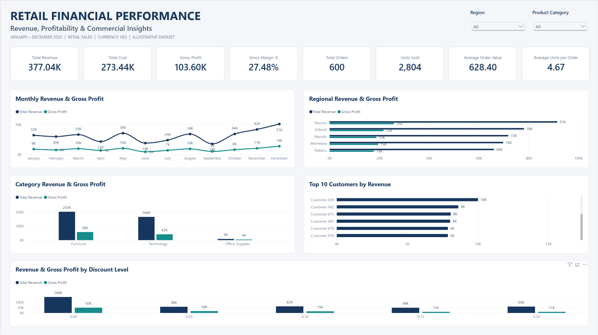

# Retail Financial Performance Analysis

## Project Overview

This project analyses a fictional retail sales dataset covering January to December 2025. Using SQL and Microsoft Power BI, I examined sales performance, revenue, costs, gross profit and gross margin across products, categories, regions, customers and discount levels.

The objective was to transform transaction-level data into financial performance indicators and management insights through SQL analysis and an interactive Power BI dashboard.

## Project Objectives

- Calculate key financial performance indicators, including revenue, cost, gross profit and gross margin.
- Analyse monthly sales and profitability trends.
- Compare financial performance across regions and product categories.
- Identify high-performing customers and product categories.
- Examine the relationship between discount levels and profitability.
- Present the findings through an interactive Power BI dashboard.

## Dataset

The project uses a fictional retail sales dataset containing 600 transaction records covering January to December 2025.

The dataset contains the following fields:

| Field | Description |
|---|---|
| OrderID | Unique order identifier |
| OrderDate | Date of the transaction |
| Customer | Customer identifier |
| Region | Geographic sales region |
| Category | Product category |
| Product | Product name |
| Quantity | Number of units sold |
| UnitPrice | Selling price per unit |
| UnitCost | Cost per unit |
| DiscountPct | Discount applied to the transaction |

The dataset is illustrative and was created for portfolio analysis. It does not represent actual business transactions.

## Tools and Technologies

| Tool | Application |
|---|---|
| CSV | Source dataset format and data import |
| SQLite | Relational database used for data storage |
| DB Browser for SQLite | Database management, SQL execution and query results inspection |
| SQL | Data aggregation, financial calculations and performance analysis |
| Microsoft Power BI | Dashboard development and data visualisation |
| DAX | Financial measures and KPI calculations |

## Methodology

### 1. Dataset Inspection

The dataset was imported into SQLite and inspected to verify the record count. SQL queries were subsequently used to aggregate transaction data and calculate financial performance indicators.

### 2. Financial Calculations

The following calculations were used:

- **Revenue:** Quantity × Unit Price × (1 − Discount Percentage)
- **Cost:** Quantity × Unit Cost
- **Gross Profit:** Revenue − Cost
- **Gross Margin:** Gross Profit ÷ Revenue × 100
- **Average Order Value:** Total Revenue ÷ Total Orders

Revenue calculations account for discounts applied to sales, while cost is calculated using the unit cost and quantity sold.

### 3. SQL Analysis

SQL was used to examine overall financial performance and investigate performance across different business dimensions.

SQL concepts applied included:

- SELECT statements and column aliases.
- Aggregate functions, including SUM() and COUNT().
- GROUP BY and ORDER BY.
- DISTINCT and COUNT(DISTINCT).
- Date-based aggregation using strftime().
- Common Table Expressions (CTEs) using WITH.
- Subqueries.
- LIMIT for restricting query results.
- ROUND() for numerical precision.
- NULLIF() for handling zero denominators in calculations.

### 4. Power BI Dashboard Development

The dataset was imported into Power BI, where DAX measures were created to calculate financial KPIs. Visualisations were developed to present overall performance and comparisons across time periods, regions, categories, customers and discount levels.

## Dashboard Preview



The dashboard presents eight key performance indicators and five visualisations covering monthly performance, regional performance, product category performance, top customers and discount levels.

## Financial Performance Results

The analysis produced the following overall results:

| Metric | Result |
|---|---:|
| Total Revenue | KES 377,042.10 |
| Total Cost | KES 273,441.50 |
| Gross Profit | KES 103,600.60 |
| Gross Margin | 27.48% |
| Total Orders | 600 |
| Units Sold | 2,804 |
| Total Customers | 80 |
| Average Order Value | KES 628.40 |
| Average Units per Order | 4.67 |

Gross profit reconciles to total revenue less total cost.

## Key Findings

### 1. Monthly Performance

December recorded the highest revenue, gross profit, units sold and order count. March recorded the highest gross margin, while November had the highest average order value.

### 2. Regional Performance

Kisumu was the strongest-performing region across the three indicators examined: revenue, gross profit and gross margin. Further investigation would be needed to understand the factors driving this performance.

### 3. Product Category Performance

Furniture generated the highest revenue and gross profit. Office Supplies recorded the highest gross margin, indicating stronger profitability relative to revenue.

### 4. Customer Performance

Customer 59 generated the highest revenue and gross profit, while Customer 75 recorded the highest gross margin. The five highest-revenue customers contributed approximately 28% of total revenue.

### 5. Discount Performance

Transactions with zero discounts recorded the highest transaction count, revenue and gross margin. The analysis also showed a general decline in gross margin as discount levels increased.

This represents an observed association in the dataset and does not establish that discounts alone caused the differences in profitability.

## Management Considerations

Based on the findings, the following areas may warrant further investigation:

- **Regional performance:** Investigate the factors contributing to Kisumu's stronger financial performance and assess whether similar approaches could be applied in other regions.
- **Product profitability:** Review the performance of Furniture and Office Supplies to understand the differences between revenue contribution and gross margin.
- **Customer concentration:** Monitor revenue contribution from the highest-performing customers and assess customer retention and concentration risks.
- **Discount management:** Evaluate discounting practices alongside product mix, transaction volumes and gross margins to understand their impact on profitability.
- **Monthly trends:** Investigate the factors behind December's sales performance and March's stronger gross margin.

These are areas for further business investigation rather than definitive operational recommendations, as the dataset does not contain additional contextual information about business decisions or market conditions.

## Project Limitations

- The dataset is synthetic and intended for illustrative portfolio analysis.
- The analysis covers one year and does not establish longer-term trends or seasonality.
- The dataset does not include operating expenses, taxes or finance costs; therefore, the analysis focuses on gross profit and gross margin rather than net profitability.
- Information on inventory levels, returns, supplier terms and other operational factors was not available.
- Customer identifiers are anonymised, limiting customer-level interpretation.

## Project Structure

```text
Retail-Financial-Performance-Analysis/
│
├── data/
│   └── financial_performance_dataset.csv
│
├── sql/
│   └── 01_data_quality_checks
│   ├── 02_record_count
│   ├── 03_transaction_analysis
│   ├── 04_overall_performance
│   ├── 05_product_performance
│   ├── 06_regional_performance
│   ├── 07_monthly_performance
│   ├── 08_monthly_sales_volume_analysis
│   ├── 09_customer_performance
│   ├── 10_top5_customer_concentration
│   ├── 11_category_performance
│   └── 12_discount_analysis
│
├── powerbi/
│   └── retail_financial_performance.pbix
│
├── screenshots/
│   └── dashboard.png
│
└── README.md
```

## Skills Demonstrated

- SQL querying and data aggregation.
- Financial performance analysis.
- Revenue, cost, gross profit and gross margin calculations.
- Common Table Expressions (CTEs) and subqueries.
- DAX measures and KPI calculations.
- Power BI dashboard development and data visualisation.
- Translating quantitative findings into management considerations.

## Author

**Margaret Muthoni**

Economics and Statistics graduate with experience in audit, financial analysis, data reporting and business operations.

